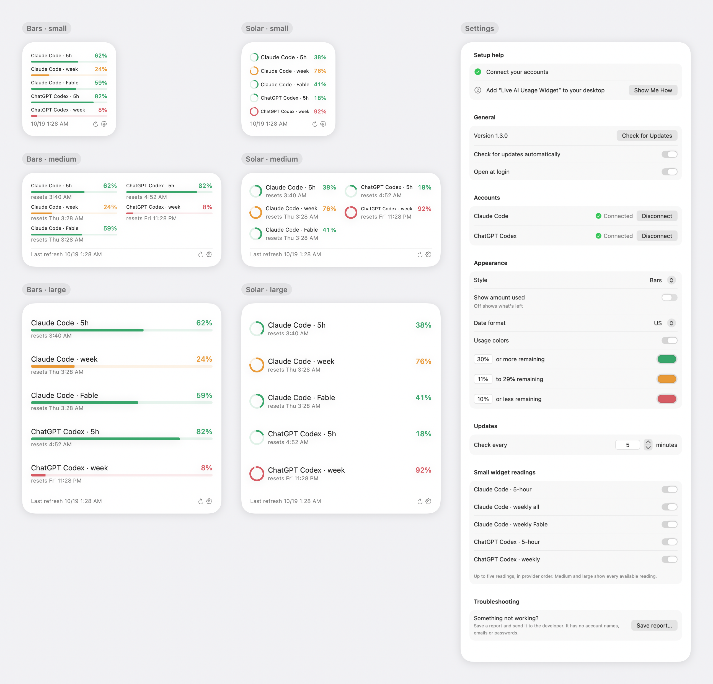

# Live AI Usage Widget

A macOS desktop widget that shows how much of your Claude Code and ChatGPT Codex usage limits are left, or how much you have used. Small, medium and large widgets come in two styles: Bars (default), which shows what is left, and Solar, rings that fill clockwise as you use your limits. Accounts and data stay on your own Mac.

**[Download for Mac (Apple Silicon)](https://github.com/jeremymorrison77/live-ai-usage-widget/releases/latest/download/Live-AI-Usage-Widget-1.3.0-macOS-arm64.zip)** · version 1.3.0 · macOS 14 or later · M1 or newer

<p align="center"></p>

Pictures are drawn from the app's own views with made-up sample readings, not a real account.

**Version 1.3.0.** Apple Silicon Macs, macOS 14 or later. Signed and notarized by Apple.

## Download and install

1. Click **Download for Mac** above, or open the [latest release](../../releases/latest) and under Assets click "Download for Mac (Apple Silicon)". The checksum files are optional.
2. Double-click the ZIP to unzip it and drag **Live AI Usage Widget** into Applications.
3. Open it from Applications. If you open it from Downloads instead, it offers to move itself into Applications. The setup window appears; follow its Setup help steps.

The app has no Dock icon. It lives in the menu bar (a ring with a pulse line): one line per account (Claude Code, ChatGPT Codex), then Settings, Check usage now and Quit. Updates: the app checks GitHub once a day and the menu shows "Update to version X" when one is out. One click downloads it, checks it is Apple-approved and from the same developer, replaces the app and reopens it; your settings are kept. With automatic checks on, the widget's status line also says "Version X available"; tapping it opens Settings. Settings also has Check for Updates and a switch to turn automatic checks off.

## Setup and settings

**Setup help** (hides itself once both steps are done; the Setup Help button brings it back)
1. Connect Claude Code, ChatGPT Codex or both.
2. Add "Live AI Usage Widget" to your desktop: right-click an empty spot on the desktop, choose Edit Widgets, search for Live AI Usage Widget, pick a size and drag it on. macOS doesn't let apps place widgets themselves. Show Me How walks through it, and the step turns green once a widget is placed.

**General.** Version and Check for updates, Check for updates automatically (on by default), Open at login (on by default).

**Accounts.** One line each for Claude Code and ChatGPT Codex: its state (Connected, Connecting…, Not installed, or what went wrong) and one button for the next step: Install, Connect, Disconnect, or Sign In, Update, Finish Setup or Try Again when something needs attention. No Terminal needed. On first launch, tools that are already installed and signed in connect on their own. Disconnect only hides that account; the tool stays signed in.

**Appearance.** Style: Bars (default) or Solar. Both use the same background and colors; only the way readings are drawn differs. Show amount used: off shows what is left, on shows what is used; each style remembers its own choice (Bars starts off, Solar starts on). Date format: US (default) or European. Usage colors on or off, with three color bands you can recolor and re-threshold (30% or more remaining, 11–29%, 10% or less by default).

**Updates.** Check every N minutes: 5 by default, any value from 1 to 1,440. After a failed check the app waits at least 15 minutes before trying again. Check usage now in the menu bar, or the refresh button on the widget, checks immediately.

**Troubleshooting.** Save report… writes a plain-text report you can send to the developer: app and tool versions, where the app runs from, whether each tool is signed in, recent checks and the past three days of activity. It never includes account names, emails, passwords or sign-in codes. The activity log lives in ~/Library/Logs/Live AI Usage Widget, keeps three days and stays under 256 KB; nothing is sent automatically.

**Small widget readings.** Choose which readings the small widget shows (up to five). Medium and large show every reading. A limit your plan doesn't have stays listed, grayed out, as "Not included in your plan" (for example, ChatGPT Pro has no 5-hour limit, and only Claude Max and Premium seats have a weekly Fable limit).

The settings window can be resized and remembers its size.

Changes apply as you make them; there is no Save button. You can close the window at any time; the widget keeps updating while the app runs.

## What it shows

- The percentage left (or used) for each limit your plan exposes: Claude Code's five-hour, weekly and any model-specific weekly windows; ChatGPT Codex five-hour and weekly. ChatGPT Codex here means Codex coding allowances, not other ChatGPT products or API billing.
- When each limit resets, and when it was last updated. Readings fade as they age and failures show their date. A newly connected account appears right away with Loading… until its first reading arrives.

## Requirements

- Apple Silicon Mac running macOS 14 or later. Intel Macs are not supported.
- Claude Code 2.1.301 or newer (`claude update`) and/or ChatGPT Codex (OpenAI's official Codex command-line tool), installed and signed into **your** account. Your plan must expose usage limits through that tool. API-key-only accounts are not supported.
- Nothing else. Python and developer tools are only needed to build from source.

No provider tools, credentials or private signing material are included.

## Known limits

Tested on two Apple Silicon Macs with real Claude Code and ChatGPT Codex accounts, and on fresh macOS 15 test Macs with neither tool, either one, and both. Not yet tested: reboots and sleep over several days, sign-ins renewing on their own over time, and revoked sign-ins. See [release checks](docs/RELEASE-CHECKLIST.md).

## Build and test

From this folder, not a parent project:

```sh
bash scripts/test.sh
python3 scripts/build.py
```

`bash scripts/render_overview.sh` redraws the picture above from the app's own views with sample readings.

This produces a **compile-only** app in `build/Live AI Usage Widget.app`. It is not a signed installer. Nothing is installed, launched, registered at login or stopped by these commands.

A maintainer with their own correctly configured signing identity can build using:

```sh
python3 scripts/build.py --team-id YOURTEAMID --signing-identity 'Developer ID Application: YOUR NAME (YOURTEAMID)' --bundle-id com.yourcompany.aiusagewidget
```

Replace the example values. Configure the app group to match `TEAMID.BUNDLEID` in both targets and verify Apple's current signing/provisioning requirements. The script only applies supplied signing settings; it does not create accounts, entitlements or profiles. See [release checks](docs/RELEASE-CHECKLIST.md).

## Set up your accounts

1. In Settings, click Install beside Claude Code or ChatGPT Codex if it isn't on your Mac yet. It downloads the official tool in the background (Anthropic's installer, or OpenAI's signed Codex release for Apple Silicon).
2. Click Connect. If you aren't signed in, your browser opens so you can sign in to your own account. The app never sees your password. If the browser doesn't open, the button becomes Open sign-in page.
3. The button shows Connecting… until your first reading arrives, then Connected. For Claude Code it also answers the one-time "trust this folder" question, only for the app's own empty working folder.

Each tool keeps and renews its own sign-in; the app only asks it for the numbers.

Before changing accounts, Disconnect that account. This clears its widget history. Then sign into the new account and Connect again. Account changes made outside this workflow cannot be reliably detected because the collector intentionally does not retain account identities.

## Privacy and uninstall

Only percentages, reset times, observation/failure timestamps and a bounded six-hour graph history are retained. The app uses provider-owned login; it never opens credential files, collects conversations, reads browser cookies or sends telemetry. The update check only asks GitHub for the latest release; nothing about you is sent. Provider CLIs themselves communicate with their services under their own policies.

Private collection state is stored under `~/Library/Application Support/BUNDLEID/`. Shared widget state and settings live in the signing team's app-group container. Source, attempt, publication and repaint times are different; see [architecture](docs/ARCHITECTURE.md).

To uninstall: turn off Open at login, choose Quit from the menu bar icon, remove its desktop widget (right-click it, Remove Widget; quitting the app does not remove it), and move the app to Trash. Optionally remove its own Application Support folder and app-group container after verifying their exact identifiers. Do not delete provider credential stores or uninstall their tools unless you separately want that. No independent LaunchAgent is installed.

## License

This is independent software, not an Anthropic or OpenAI product. Provider names identify compatibility only.

Released under the [MIT License](LICENSE). See [third-party notices](THIRD-PARTY-NOTICES.md).

