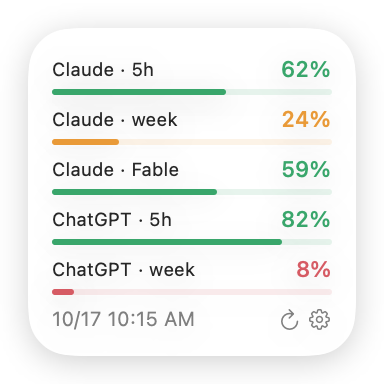
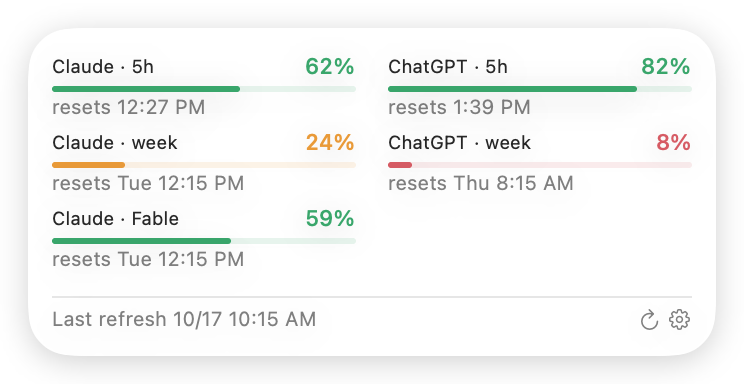
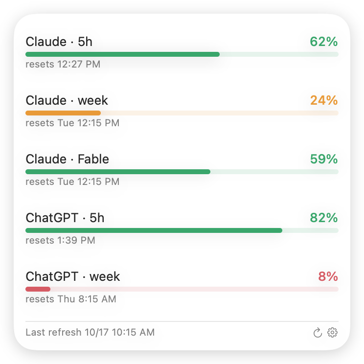
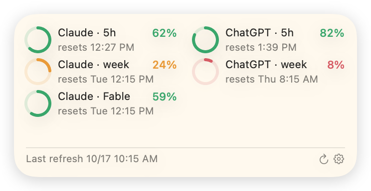
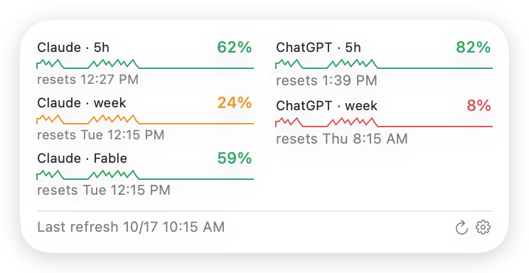
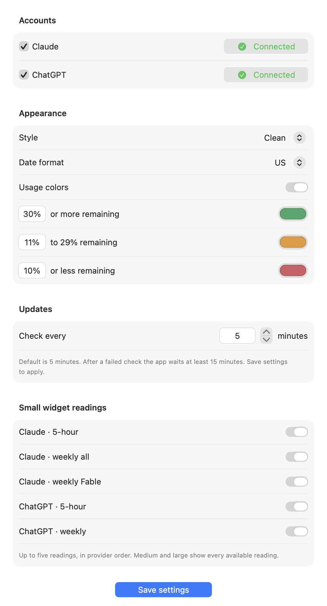

# Live AI Usage Widget

A macOS desktop widget that shows how much of your Claude Code and ChatGPT/Codex coding allowance is left. Small, medium and large widgets come in Clean (default), Solar and Trends styles. Accounts and data stay on your own Mac.

**[Download for Mac (Apple Silicon)](https://github.com/jeremymorrison77/live-ai-usage-widget/releases/latest/download/Live-AI-Usage-Widget-1.0.0-macOS-arm64.zip)** · version 1.0.0 · macOS 14 or later · M1 or newer

<p align="center">
  
  
</p>
<p align="center">
  
</p>

| Solar | Trends |
| --- | --- |
|  |  |

**Setup window**

<p align="center"></p>

Pictures are drawn from the app's own views with made-up sample readings, not a real account.

**Version 1.0.0.** Apple Silicon Macs, macOS 14 or later. Signed and notarized by Apple.

## Download and install

1. Click **Download for Mac** above, or open the [latest release](../../releases/latest) and under Assets click "Download for Mac (Apple Silicon)". The checksum files are optional.
2. Double-click the ZIP to unzip it and drag **Live AI Usage Widget** into Applications.
3. Open it. The setup window appears; follow its three Get started steps.

The app has no Dock icon. It lives in the menu bar (a ring with a pulse line) with Settings, Check now and Quit. To update later, quit it from that menu, replace it in Applications and reopen it; your settings are kept.

## Setup and settings

**Get started** (hides itself once all three are done; the Setup help button brings it back)
1. Turn on Claude, ChatGPT or both, then connect them.
2. Add the widget to your desktop: right-click an empty spot on the desktop, choose Edit Widgets, search for Live AI Usage Widget, pick a size and drag it on. macOS doesn't let apps place widgets themselves. Show me how walks through it, and the step turns green once a widget is placed.
3. Turn on Open at login so it keeps running.

**Accounts.** Check Claude, ChatGPT or both. Connect opens a sheet with Sign in (runs the official sign-in in Terminal), Finish Claude setup and Check connection. "Connected" appears only after a fresh reading.

**Appearance.** Style: Clean (default), Solar or Trends. Date format: US or European. Usage colors on or off, with three color bands you can recolor and re-threshold (30% or more remaining, 11–29%, 10% or less by default).

**Updates.** Check every N minutes: 5 by default, any value from 1 to 1,440. After a failed check the app waits at least 15 minutes before trying again. Check now in the menu bar checks immediately.

**Small widget readings.** Choose which readings the small widget shows (up to five). Medium and large show every reading.

Save settings applies changes. You can close the window at any time; the widget keeps updating while the app runs.

## What it shows

- Remaining percentage for each limit your plan exposes: Claude's five-hour, weekly and any model-specific weekly windows; ChatGPT/Codex five-hour and weekly. ChatGPT here means Codex coding allowances, not other ChatGPT products or API billing.
- When each limit resets, and when it was last updated. Readings fade as they age and failures show their date.
- Trends style adds a six-hour history of how fast each limit is being used. Gaps are drawn flat; nothing is invented.

## Requirements

- Apple Silicon Mac running macOS 14 or later. Intel Macs are not supported.
- Claude Code 2.1.301 or newer (`claude update`) and/or the official Codex CLI, installed and signed into **your** account. Your plan must expose usage limits through that tool. API-key-only accounts are not supported.
- Nothing else. Python and developer tools are only needed to build from source.

No provider tools, credentials or private signing material are included.

## Known limits

Tested on two Apple Silicon Macs with real Claude and ChatGPT accounts. Not yet tested: installing as a brand-new macOS user, reboots and sleep over several days, sign-ins renewing on their own over time, and revoked sign-ins. See [release checks](docs/RELEASE-CHECKLIST.md).

## Build and test

From this folder, not a parent project:

```sh
bash scripts/test.sh
python3 scripts/build.py
```

This produces a **compile-only** app in `build/Live AI Usage Widget.app`. It is not a signed installer. Nothing is installed, launched, registered at login or stopped by these commands.

A maintainer with their own correctly configured signing identity can build using:

```sh
python3 scripts/build.py --team-id YOURTEAMID --signing-identity 'Developer ID Application: YOUR NAME (YOURTEAMID)' --bundle-id com.yourcompany.aiusagewidget
```

Replace the example values. Configure the app group to match `TEAMID.BUNDLEID` in both targets and verify Apple's current signing/provisioning requirements. The script only applies supplied signing settings; it does not create accounts, entitlements or profiles. See [release checks](docs/RELEASE-CHECKLIST.md).

## Set up your accounts

1. Install the provider's official command-line tool using its own instructions. Finish its first-run setup in Terminal.
2. Run `claude auth login` or `codex login` and complete the provider-owned authentication. Never paste credentials into this app.
3. Open the app. In the setup window select the providers you want and save. Connect → Sign in launches the official login command in Terminal; Check connection reads usage after sign-in.
4. “Connected” appears only after a fresh successful usage reading. Sign-in or rate-limit failures can delay the next attempt by fifteen minutes.
5. Add the widget and turn on Open at login as described above. Keep the app running; closing its window is fine, quitting stops checks.

Before changing accounts, turn off that provider and save. This clears widget history and invalidates the collector cache. Then sign into the new account, enable the provider and save again. Account changes made outside this workflow cannot be reliably detected because the collector intentionally does not retain account identities.

## Privacy and uninstall

Only percentages, reset times, observation/failure timestamps and a bounded six-hour graph history are retained. The app uses provider-owned login; it never opens credential files, collects conversations, reads browser cookies or sends telemetry. Provider CLIs themselves communicate with their services under their own policies.

Private collection state is stored under `~/Library/Application Support/BUNDLEID/`. Shared widget state and settings live in the signing team's app-group container. Source, attempt, publication and repaint times are different; see [architecture](docs/ARCHITECTURE.md).

To uninstall: turn off Open at login, choose Quit from the menu bar icon, remove its desktop widget, and move the app to Trash. Optionally remove its own Application Support folder and app-group container after verifying their exact identifiers. Do not delete provider credential stores or uninstall their tools unless you separately want that. No independent LaunchAgent is installed.

## License

This is independent software, not an Anthropic or OpenAI product. Provider names identify compatibility only.

Released under the [MIT License](LICENSE). See [third-party notices](THIRD-PARTY-NOTICES.md).

Claude first-run setup: after sign-in, use **Finish Claude setup** in the connection sheet to approve the widget working folder in Terminal. Close that Terminal window, then choose **Check connection**. Older CLI versions are reported as needing an update, not as network timeouts.
