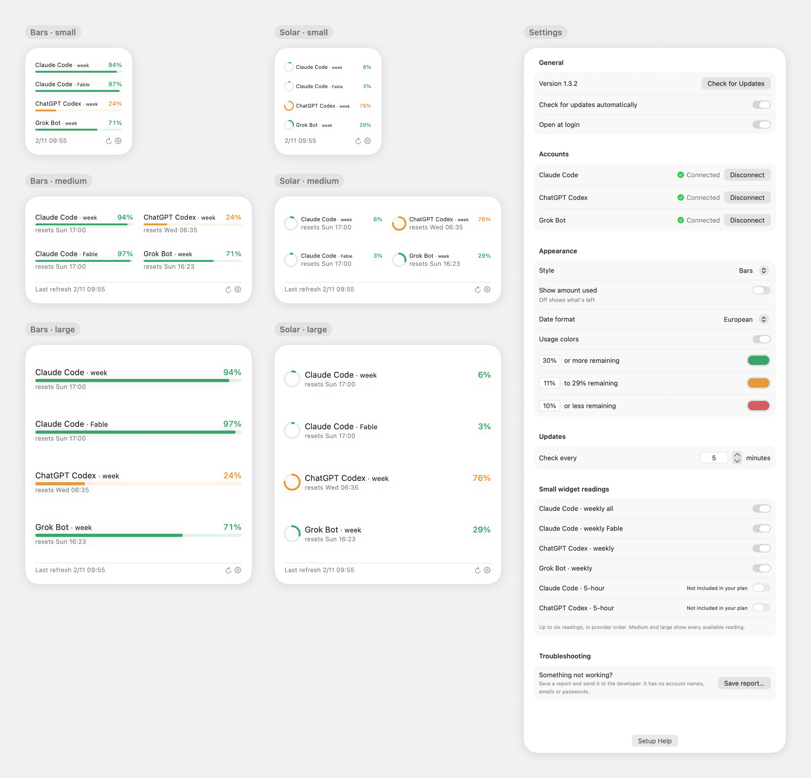

# Live AI Usage Widget 1.3.2

**[Download for Mac (Apple Silicon)](https://github.com/jeremymorrison77/live-ai-usage-widget/releases/download/v1.3.2/Live-AI-Usage-Widget-1.3.2-macOS-arm64.zip)**, or choose it under Assets.

A macOS desktop widget for Claude Code, ChatGPT Codex and Grok Bot usage. Version 1.3.2, build 34. Apple Silicon, macOS 14 or later. Developer ID signed and notarized by Apple.

## What's new

- Grok Bot is a third account, showing weekly usage and its reset time from a local file written by a Grok Bot routine. See the [feed setup](https://github.com/jeremymorrison77/live-ai-usage-widget/blob/v1.3.2/docs/GROKBOT-FEED.md). Readings older than three hours fade.
- Small widgets support up to six readings. Medium and large widgets include every available reading, including Grok Bot.
- Widgets redraw only on a new reading or changed outcome, preserving macOS's reload budget when the same local file is checked each minute.
- No shared-with-other-apps text appears in widgets or Settings. The optional feed field is still accepted.
- Refreshed pictures cover Bars and Solar in all three sizes and the current Settings panel, using real local readings without account identities.

## Install or update

1. Download and unzip the Mac archive.
2. Drag **Live AI Usage Widget** into Applications and open it.
3. Follow Setup help to connect accounts and add a desktop widget. For Grok Bot, first arrange the local feed routine.

On 1.1.1 or later, use Check for Updates in Settings or choose Update to version 1.3.2 in the menu bar after this release is published. Automatic checks run once a day. The GitHub full release is the update feed; there is no separate appcast.

## Validation and known limits

Prepared locally November 2, 2026. All 18 Python tests and both native Swift suites passed. Developer ID signature verification, notarization, staple validation and Gatekeeper assessment passed. Notary submission: `69f0721f-2646-40df-bdad-412d90783c7b` (Accepted). App ZIP SHA-256: `22bcd2a5c1ad634e9a6e0b8f33de1f563150f737ebf5b48290deb5558fdfc499`.

The installed build 34 Settings panel shows all three accounts connected. All six rendered widget layouts and Settings were inspected. Direct live comparison with every desktop size/style on both displays remains unverified. The real accounts expose four readings; six-reading capacity is implemented, but a live six-reading layout was not verified with these accounts.

Earlier versions were tested on two Apple Silicon Macs and fresh macOS 15 test users. Fresh-Mac installation and download-back verification of this release await publication. Grok Bot has only been tested with the local feed. Multi-day reboot/sleep behavior, natural sign-in renewal and revoked authorization remain unverified. Intel is unsupported. Apple notarization does not establish compatibility with every account or Mac.
